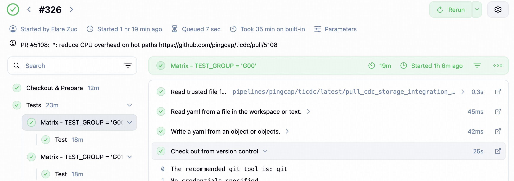
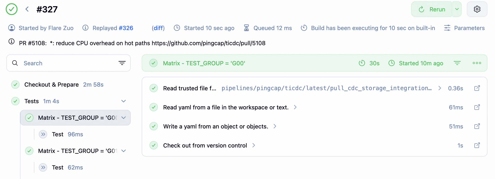

# matrixCache

`matrixCache` is a small cache for rerunning Jenkins matrix stages. When a matrix axis succeeds, it writes a local marker file; the next run of the same code context can skip the axes that already succeeded and only execute the ones that still need to run.

## Background

Large CI pipelines usually split one kind of test across many parallel axes, for example by `TEST_GROUP`, `OS`, `ARCH` or another dimension.

That has a common problem: if only a few axes failed in one build because of a transient environment issue, rerunning the whole pipeline also re-runs every axis that already passed. The cost is direct:

- longer reruns and slower feedback
- more Jenkins agents, containers and storage consumed
- the axes that actually need attention drowned out by repetition

`matrixCache` solves that: without changing the stage logic, a matrix stage skips the axes that already succeeded when it is rerun.

## Design

The idea is simple: build a stable key from "current code context + current stage + current axis parameters" and keep a success marker on the Jenkins controller's local filesystem.

### Key composition

The shared library lives at `libraries/tisys/vars/matrixCache.groovy`. It concatenates:

- `refs.org`
- `refs.repo`
- `refs.base_sha`
- `refs.pulls[*].sha`
- the caller's `stageName`
- the caller's `extraParams`

The raw format is equivalent to:

```text
org/repo/baseSha/pullShas/stageName/extras
```

`extraParams` is sorted by key before it is joined, so the same set of parameters yields the same key regardless of how the map was written.

To keep file names short, the library hashes that raw string with MD5; the digest is the final cache key.

### Marker location

Markers are stored at:

```text
${JENKINS_HOME}/matrix-cache/${JOB_NAME.replaceAll('/', '_')}/${key}.success
```

So the cache is bounded in a few ways:

- scope is per `JOB_NAME`; different Jenkins jobs do not share entries
- it lives on the Jenkins controller's local filesystem, not in a remote shared cache
- changing `refs`, `stageName` or `extraParams` maps to a different key

## Implementation

### Shared library interface

`matrixCache` exposes two core methods:

```groovy
def shouldSkip(Map refs, String stageName, Map extraParams = [:]) {
    def key = _generateContextKey(refs, stageName, extraParams)
    def cacheDir = new File("${env.JENKINS_HOME}/matrix-cache/${env.JOB_NAME.replaceAll('/', '_')}")
    def markerFile = new File(cacheDir, "${key}.success")
    return markerFile.exists()
}

def markDone(Map refs, String stageName, Map extraParams = [:]) {
    def key = _generateContextKey(refs, stageName, extraParams)
    def cacheDir = new File("${env.JENKINS_HOME}/matrix-cache/${env.JOB_NAME.replaceAll('/', '_')}")
    if (!cacheDir.exists()) cacheDir.mkdirs()

    def markerFile = new File(cacheDir, "${key}.success")
    if (!markerFile.exists()) {
        markerFile.text = "SUCCESS"
    }
}
```

Their behaviour:

- `shouldSkip()`: before the stage starts, check whether the success marker already exists
- `markDone()`: after the stage succeeds, write the success marker

`markDone()` is only called from `post { success {} }`, so a failed axis never pollutes the cache.

### Pipeline integration

The recommended wiring in a pipeline is:

1. call `shouldSkip()` in `when`
2. call `markDone()` in `post { success {} }`
3. both calls must use exactly the same `stageName` and `extraParams`

The ticdc pilot job `jenkins/jobs/pingcap/ticdc/latest/pull_cdc_storage_integration_light_next_gen/Jenkinsfile` is wired like this:

```groovy
stage("Test") {
    when {
        expression {
            return !matrixCache.shouldSkip(REFS, 'Test', [test_group: env.TEST_GROUP])
        }
    }
    steps {
        sh label: "${TEST_GROUP}", script: """
            ./tests/integration_tests/run_light_it_in_ci.sh storage ${TEST_GROUP}
        """
    }
    post {
        success {
            script {
                matrixCache.markDone(REFS, 'Test', [test_group: env.TEST_GROUP])
            }
        }
    }
}
```

It uses the stable stage key `'Test'` and passes the matrix dimension `[test_group: env.TEST_GROUP]` explicitly to both call sites, so reads and writes use exactly the same key.

## Usage

### When it fits

`matrixCache` suits stages that:

- are idempotent, so a rerun does not depend on state left by the previous attempt
- would only burn resources if a successful axis were run again
- should reuse results within the same code context, not across commits

### Integration steps

1. pick a stable `stageName`
2. pick the parameters that uniquely identify the current axis and put them in `extraParams`
3. call `!matrixCache.shouldSkip(...)` in `when`
4. call `matrixCache.markDone(...)` in `post { success {} }`
5. make sure both calls use identical `refs`, `stageName` and `extraParams`

A generic example:

```groovy
stage("Unit Test") {
    when {
        expression {
            return !matrixCache.shouldSkip(
                REFS,
                'Unit Test',
                [os: env.OS, arch: env.ARCH]
            )
        }
    }
    steps {
        sh "make test"
    }
    post {
        success {
            script {
                matrixCache.markDone(
                    REFS,
                    'Unit Test',
                    [os: env.OS, arch: env.ARCH]
                )
            }
        }
    }
}
```

### Caveats

- Do not use `env.STAGE_NAME` as part of the cache key in matrix scenarios. Because of `JENKINS-69394`, `env.STAGE_NAME` may differ between the `when` and `post` contexts.
- `shouldSkip()` and `markDone()` must use identical `stageName` and `extraParams`, otherwise one key is read and another is written.
- `extraParams` must cover every axis dimension that really affects the result. A missing dimension causes false cache hits.
- The cache lives on the Jenkins controller's local filesystem. Switching controllers, wiping `${JENKINS_HOME}`, or renaming the job means old entries stop applying.

## Replays and the cache

A Jenkins replay is a new build of the same job with the same `JOB_SPEC`, so `refs`, `stageName` and `extraParams` are identical and `_generateContextKey()` returns exactly the key of the original build. If the cache applied, the replay would skip every stage that had already passed: a green log for a build that re-ran nothing.

`matrixCache` recognises that case itself:

- `isReplayBuild()` reads `currentBuild.getBuildCauses()` and looks for `org.jenkinsci.plugins.workflow.cps.replay.ReplayCause`, the cause Jenkins attaches to a replayed build.
- When it matches, `shouldSkip()` returns `false` and the build log gets
  `matrix cache bypassed because this is a replay build; every stage runs and no marker is read`.
  It is logged once per build, because a matrix `when` is evaluated once per axis.
- `markDone()` is unchanged: a successful replay still writes markers under the same key as a normal build, so caching semantics do not change.
- When the causes cannot be read (plugin version, sandbox restriction, no pipeline context), the library logs one warning and treats the build as "not replayed", so the pipeline never fails because of the check.

`.ci/replay-jenkins-build.sh` therefore re-runs every stage without passing anything. It could not pass anything either: the second argument of `ReplayAction.run2(mainScript, map)` replaces loaded scripts by class name, and `run2` copies the source build's parameters as they are.

### Manual bypass

To skip the cache on purpose, pass the parameter explicitly (case-insensitive; the job has to declare it, `matrixCache` only reads it):

```groovy
parameters {
    booleanParam(name: 'MATRIX_CACHE_BYPASS', defaultValue: false,
                 description: 'Re-run every matrix stage instead of skipping cached ones')
}
```

Ordinary (non-replay) builds behave exactly as before when the parameter is absent or not `true`.

## Examples in practice

The screenshots below come from the ticdc pilot job `pull_cdc_storage_integration_light_next_gen`.

### First run

On the first run every `TEST_GROUP` axis executes the `Test` stage.



### Rerun of the same context

When the same code context is rerun, the axes that already succeeded are skipped quickly: in the UI the `Test` stage goes straight to `SKIPPED`, leaving only the parts that really need a rerun.


